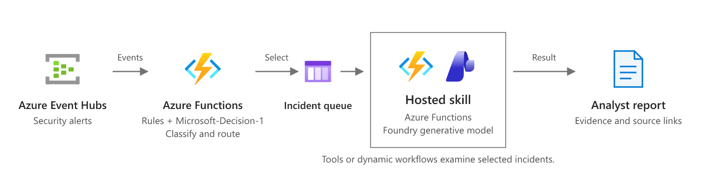

# Alert investigation (Event Hubs + Microsoft-Decision-1 + queue-triggered hosted skill)

Security and operations alerts stream into Event Hubs, sometimes thousands per minute. A code function filters them with deterministic rules, then routes what's left with [Microsoft-Decision-1](https://ai.azure.com/catalog/models/Microsoft-Decision-1). Only the alerts worth a closer look reach a hosted skill on Azure Functions, which gathers evidence and writes an investigation report: a **verdict**, the **evidence**, and the **recommended containment**. Containment is never executed automatically.

This is the [security/operations alert investigation scenario](https://learn.microsoft.com/azure/azure-functions/functions-hosted-skills-scenarios#investigate-selected-events) at high volume as a runnable template. Run `azd up`, send the sample burst of alerts, and read the routing decisions and reports.



*Scenario overview from [Investigate selected events](https://learn.microsoft.com/azure/azure-functions/functions-hosted-skills-scenarios#investigate-selected-events) on Microsoft Learn. The diagram below shows how this template implements it.*

```text
 alerts ──► Event Hubs: alerts ──► alert_router (code, function_app.py)
                                     │ 1. validate          invalid           ──► Queue: alerts-review
                                     │ 2. suppress          known-benign rule ──► Table: alertdecisions (suppressed)
                                     │ 3. dedupe            same fingerprint in the window ──► Table: alertfingerprints (count)
                                     │ 4. group by host/user
                                     │ 5. critical?         yes ──────────────► Queue: alerts-investigate
                                     │ 6. Microsoft-Decision-1 "route" choice question
                                     │      investigate ────────────────────────► Queue: alerts-investigate
                                     │      aggregate / routine ────────────────► Table: alertdecisions (the summary)
                                     │      uncertain, low confidence, or error ► Queue: alerts-review
                                     ▼
 Queue: alerts-investigate ──► alert_investigator.agent.md ──► Blob: investigations/{group_id}.json
                                │  hosted skill (Flex Consumption)
                                ├─ get_asset                 (owner, criticality, tags)
                                ├─ get_signin_logs           (identity provider sign-ins)
                                ├─ get_endpoint_events       (process, file, and EDR events)
                                ├─ get_network_flows         (connections and bytes out)
                                ├─ lookup_threat_intel       (IPs, domains, hashes)
                                ├─ execute_containment_action (always refuses; containment is recommended only)
                                └─ record_investigation      (idempotent; approval enforced in code)
```

Every routing outcome, including suppressed alerts and Decision-1 errors, is written to the `alertdecisions` table with its source, choice, and per-option probabilities. Nothing is silently dropped.

## Why this scenario uses two stages

Most alerts in a busy SOC are noise: the same disk-space warning five times, an authorized vulnerability scan, a password-expiry reminder. Sending all of them to a language model is slow and expensive, and an analyst still has to read every result. This template splits the work by cost:

- **Code** handles the rules you can write down: suppress known-benign alerts, drop duplicates, group related alerts, and send critical alerts straight to investigation. It costs almost nothing per event and keeps up with Event Hubs volume.
- **Microsoft-Decision-1** answers one structured question per remaining alert group: *investigate, aggregate, routine, or uncertain?* It returns a choice plus a probability for each option, so the code can fail safe on low confidence. It's a fast, inexpensive call. No prompt engineering or output parsing is needed.
- **The hosted skill** does the expensive part, an evidence-gathering investigation with a reasoning model, only for the few alerts that deserve one.

The sample burst shows the range:

| Alert | Situation | What happens |
|---|---|---|
| `ALR-1001` | **Critical** EDR ransomware behavior on `fin-ws-22` | Critical bypass. Skips Decision-1 and goes straight to investigation. |
| `ALR-1002` | Medium: impossible travel, then a privileged role assignment | Decision-1 → `investigate`, then a report is written |
| `ALR-1003`–`ALR-1007` | Five identical low disk-space warnings | `ALR-1003` is routed; `1004`–`1007` are deduplicated (duplicate count 4) |
| `ALR-1008` | Informational password-expiry reminder | Decision-1 → `routine` (summary only) |
| `ALR-1009` | Port scan from the authorized scanner `scan-01` | Suppressed by rule `SUP-001` |
| `ALR-1010` | Phishing email already quarantined | Decision-1 → `aggregate` (summary only) |

All of the data the skill investigates (sign-ins, endpoint events, network flows, assets, and threat intel) is mock JSON in `src/data`. Replace the tools with calls to your SIEM, EDR, and identity provider; see [Make it yours](#make-it-yours).

## Prerequisites

- An Azure subscription where you can deploy a Microsoft Foundry model and `Microsoft-Decision-1` (the template deploys both).
- [Azure Developer CLI](https://aka.ms/azd) (`azd`) 1.10 or later, and [Azure CLI](https://learn.microsoft.com/cli/azure/install-azure-cli) (`az`).
- Python 3.13.
- For local runs: [Azure Functions Core Tools](https://learn.microsoft.com/azure/azure-functions/functions-run-local) 4.x and [Azurite](https://learn.microsoft.com/azure/storage/common/storage-use-azurite).

## Deploy to Azure

```bash
git clone https://github.com/Azure-Samples/azure-functions-hosted-skills-samples
cd azure-functions-hosted-skills-samples/alert-investigation-eventhub
azd auth login
az login
azd up
```

Pick a region where Microsoft-Decision-1 is available with Global Standard: `eastus2` (default), `eastus`, `centralus`, `northcentralus`, `southcentralus`, `westus`, `westus3`, `canadacentral`, `canadaeast`, or `brazilsouth`.

`azd up` creates a resource group with:

- A Flex Consumption function app with a user-assigned managed identity. It runs both the `alert_router` Event Hubs function and the `alert_investigator` hosted skill.
- An Event Hubs namespace (Standard) with the `alerts` hub and two consumer groups: `alert-router` for the app and `local-dev` for running locally.
- A storage account (no shared key access) with:
  - the `alerts-investigate` and `alerts-review` queues
  - the `investigations` container
  - the `alertdecisions` and `alertfingerprints` tables
- A Microsoft Foundry account and project with two deployments: `gpt-5.4` for the skill, and `decision-1`, which runs the `Microsoft-Decision-1` model, for routing.
- Application Insights and Log Analytics.

All connections use the managed identity. The app gets Event Hubs Data Receiver, Cognitive Services User, and storage data roles. Your signed-in account gets Event Hubs Data Sender and Receiver, Cognitive Services User, and storage data roles, so you can run the demo and the app locally.

### Microsoft-Decision-1 notes

- The deployment is named `decision-1` because Azure rejects deployment names that contain the reserved word "Microsoft". The model it runs is still `Microsoft-Decision-1`, version `1`.
- The router calls `POST {account endpoint}/providers/microsoft/v1/systemone` with an Entra ID token (scope `https://cognitiveservices.azure.com/.default`). The client is in `src/alert_router/decision.py`.
- Each capacity unit allows **1 request and 1,000 tokens per minute**. With capacity 1, even the 10-alert sample burst is throttled. The template deploys **capacity 50** by default. Usage is billed per call, not per unit. To change it, run `azd env set DECISION_CAPACITY <n>` and then `azd provision`. A capacity change can take a few minutes to reach the data plane.
- On HTTP 429, the client honors `retry-after-ms`/`retry-after` (capped at 30 seconds) for up to 6 attempts. If it still fails, the alert group goes to `alerts-review` with source `decision1_error`.

## Try it

```bash
python -m venv .venv
# Windows: .venv\Scripts\activate    macOS/Linux: source .venv/bin/activate
pip install --pre -r requirements-dev.txt

python scripts/demo.py send       # send the sample burst to the deployed Event Hub
python scripts/demo.py results    # print today's routing decisions and investigation reports
```

`python scripts/demo.py e2e` sends a uniquely tagged copy of the burst, waits for routing and investigations, and then checks the outcome:

- the critical alert was investigated
- the duplicates were deduplicated
- the routine alerts were summarized
- Decision-1 routed the rest

Example output (from a real run):

```text
Routing decisions:
  ALR-1001: investigate source=critical_bypass          alerts=1 [-]
  ALR-1002: investigate source=decision1                alerts=1 [investigate=1.00, uncertain=0.00, aggregate=0.00, routine=0.00]
  ALR-1003: routine     source=decision1                alerts=1 [routine=1.00, aggregate=0.00, uncertain=0.00, investigate=0.00]
  ALR-1004: (no record - deduplicated or not processed yet)
  ...
  ALR-1008: routine     source=decision1                alerts=1 [routine=1.00, aggregate=0.00, uncertain=0.00, investigate=0.00]
  ALR-1009: suppressed  source=suppression_rule         alerts=1 [-]
  ALR-1010: aggregate   source=decision1                alerts=1 [aggregate=1.00, investigate=0.00, uncertain=0.00, routine=0.00]

Duplicate count on ALR-1003: 4

Investigation ALR-1001: malicious (high) severity=critical
  fin-ws-22 was compromised through a malicious macro document opened by m.garcia, which launched PowerShell,
  downloaded a known LockDrop ransomware loader, and executed it via rundll32. The host then deleted shadow copies,
  uploaded a large volume of data to a known LockDrop C2 IP, and encrypted 1,842 files locally and on the mapped
  finance share \\fs-02\finance.
  - recommend isolate_host fin-ws-22 [immediate] executed=False
  - recommend block_indicator 185.220.101.47 [immediate] executed=False
  - recommend block_indicator contoso-invoices.co [immediate] executed=False
  - recommend preserve_evidence fin-ws-22 [immediate] executed=False
  - recommend reset_credentials m.garcia [within_24h] executed=False
  ...

Investigation ALR-1002: malicious (high) severity=critical
  a.patel, a privileged Cloud Administrator, appears to have been compromised via MFA fatigue: six MFA push denials
  from Lagos, NG on an unknown Windows/Chrome device were followed by a successful Azure Portal sign-in from the same
  IP and then an Owner role assignment on the production subscription.
  - recommend disable_account a.patel [immediate] executed=False
  - recommend revoke_sessions a.patel [immediate] executed=False
  - recommend remove_role_assignment Owner on sub-contoso-prod for a.patel [immediate] executed=False
  ...
```

Each report is a JSON document in the `investigations` container named `{group_id}.json`. The group ID is the alert ID of the group's highest-severity alert. Send your own alerts as JSON events with `alert_id`, `source`, `rule_id`, `title`, `severity`, `host` and/or `user`, `detected_at`, `description`, and `evidence`; `samples/alert-burst.json` shows the shape.

Watch the run in Application Insights, or stream logs with `func azure functionapp logstream <app-name>`.

## Run locally

There's no Event Hubs emulator in this template. Locally, the app reads from the **deployed** namespace through the `local-dev` consumer group, so it doesn't compete with the app in Azure, and uses Azurite for storage. The router is disabled in the settings sample (`AzureWebJobs.alert_router.Disabled`), so `func start` works without any Azure resources.

1. Start Azurite (`azurite`, or `docker run -p 10000-10002:10000-10002 mcr.microsoft.com/azure-storage/azurite`).
2. Create the settings file:

   ```bash
   cp src/local.settings.json.sample src/local.settings.json
   ```

3. After `azd up`, fill in these values in `src/local.settings.json` from `azd env get-values`:

   | Setting | Value |
   |---|---|
   | `FOUNDRY_PROJECT_ENDPOINT` | `FOUNDRY_PROJECT_ENDPOINT` |
   | `DECISION_ENDPOINT` | `DECISION_ENDPOINT` |
   | `EVENTHUB__fullyQualifiedNamespace` | `EVENTHUB_FULLY_QUALIFIED_NAMESPACE` |

   Then set `AzureWebJobs.alert_router.Disabled` to `false`. Leave `EVENTHUB_CONSUMER_GROUP` as `local-dev`.
4. Start the app from `src` with the virtual environment active. From another terminal, send alerts and read the results from Azurite:

   ```bash
   cd src && func start
   python scripts/demo.py send --local
   python scripts/demo.py results --local
   ```

Locally, the app uses your `az login` identity for Event Hubs, Microsoft-Decision-1, and Foundry. `azd up` already granted that identity the roles it needs.

## Make it yours

| To change | Edit |
|---|---|
| Known-benign suppressions | `src/data/suppressions.json` (match on `rule_id` plus `host`, `user`, or `asset_tag`) |
| Dedupe window and Decision-1 confidence threshold | `DEDUPE_WINDOW_MINUTES` and `DECISION_MIN_CONFIDENCE` app settings (`infra/main.bicep`) |
| What counts as a duplicate, and how alerts are grouped | `fingerprint` and `group_alerts` in `src/alert_router/rules.py` |
| Routing options and their criteria for Decision-1 | `ROUTE_OPTIONS` and `INSTRUCTIONS` in `src/alert_router/router.py` |
| Investigation steps, verdict rules, and report tone | `src/alert_investigator.agent.md` |
| Evidence sources (SIEM, EDR, IdP, CMDB, threat intel) | `src/tools/get_*.py` and `lookup_threat_intel.py`. Replace the `src/data/*.json` reads with your APIs. |
| Where reports go (SOAR case, ticket, Teams) | `src/tools/record_investigation.py` and `_storage.py` |
| Sample alerts | `samples/alert-burst.json` |
| Models | `azd env set FOUNDRY_MODEL ...` and the deployments in `infra/app/foundry.bicep` |

## Guardrails built in

- **Recommend, don't act.** `execute_containment_action` always refuses. `record_investigation` stores every containment action with `executed: false` and `status: pending_approval`. It also sets `requires_human_approval` whenever containment is recommended or the verdict is `malicious` or `suspicious`, regardless of what the model says. Isolating a host or disabling an account stays with an analyst and your SOAR approval flow.
- **Fail safe, never silent.** Invalid events, `uncertain` answers, low-confidence answers (below `DECISION_MIN_CONFIDENCE`), and Decision-1 errors all go to the `alerts-review` queue. Each one is recorded with the reason.
- **Critical alerts bypass the model.** Critical alerts go straight to investigation and are never suppressed.
- **Escalations aren't deduplicated.** Severity is part of the fingerprint, so a low alert followed by a critical one on the same host is treated as new.
- **Alert content is data, not instructions.** The skill is told to treat alert descriptions and log content as evidence to report, never as instructions to follow.
- **Idempotent.** Event Hubs and queues deliver at least once. The fingerprint claim and the report write (`overwrite=False`) both detect replays, so a retry doesn't double-count duplicates or write a second report.
- **No extra reach.** `web_request` and MCP are disabled for this skill. It can only call its seven tools.

## Test

From the repository root:

```bash
python scripts/test.py --template alert-investigation-eventhub                      # Bicep build, skill/tool loading, unit tests
python scripts/test.py --template alert-investigation-eventhub --level local        # + func start (function registration)
python scripts/test.py --template alert-investigation-eventhub --level deploy --down  # + azd up, e2e, azd down
```

The unit tests in `tests/` cover:

- the rules
- the Decision-1 client, with mocked HTTP, including 429 retries
- the routing pipeline and fail-safe paths
- the storage idempotency
- the tools
- the demo validation

## Troubleshooting

- **Routing decisions show `decision1_error` with `HTTP 429 RateLimitReached`.** The `decision-1` deployment ran out of requests per minute. Raise the capacity with `azd env set DECISION_CAPACITY <n>` and then `azd provision`. Allow a few minutes after a capacity change. The affected alerts are in `alerts-review`.
- **`azd up` fails with `ContainsReservedWord`.** A deployment name contains "Microsoft". Keep `decisionDeploymentName` as `decision-1` (or any name without the reserved word).
- **`azd up` fails while uploading the package with `403 ... not authorized to perform this operation`.** The app's role assignments were just created and haven't reached Storage yet. Wait a minute and run `azd deploy`.
- **`demo.py send` fails with `Unauthorized`, or the router logs `403` from Event Hubs or Decision-1.** Role assignments can take a few minutes to propagate after `azd up`. Try again.
- **No routing decisions appear.** Check the `alert_router` function's logs in Application Insights. For local runs, make sure `AzureWebJobs.alert_router.Disabled` is `false` and `EVENTHUB__fullyQualifiedNamespace` is set.

## Clean up

```bash
azd down --purge
```
