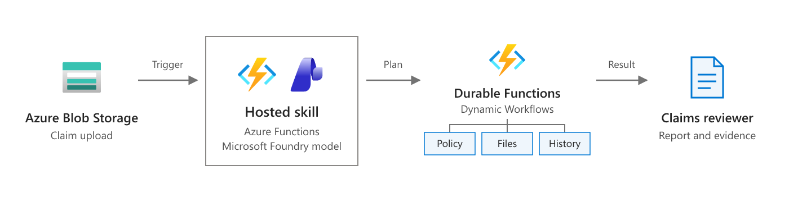
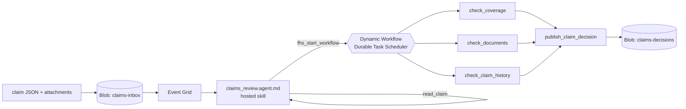

# Insurance claims review (Dynamic Workflows)

An insurance claim package — a JSON claim form plus its supporting documents — is uploaded to Blob Storage. A hosted skill on Azure Functions reads the claim and starts a **Dynamic Workflow**: coverage, required documents, and claim history are checked in parallel as durable workflow steps, then a final step records a decision — **approve**, **request_info**, or **refer_to_adjuster** — with every reason.

This is the [insurance claims review scenario](https://learn.microsoft.com/azure/azure-functions/functions-hosted-skills-scenarios#plan-a-multistep-review) as a runnable template: `azd up`, upload the sample claims, and read the decisions. Workflow state runs on [Durable Task Scheduler](https://learn.microsoft.com/azure/azure-functions/durable/durable-task-scheduler/durable-task-scheduler), so every run can be inspected step by step in its dashboard.



*Scenario overview from [Plan a multistep review](https://learn.microsoft.com/azure/azure-functions/functions-hosted-skills-scenarios#plan-a-multistep-review) on Microsoft Learn. The diagram below shows how this template implements it.*



## Why this scenario fits a hosted skill with a workflow

Claim forms are messy: free-text loss descriptions, attachments with inconsistent names, and the occasional "please pay quickly". The model is good at reading that and writing a note an adjuster can use. The checks that decide the outcome — is the policy in force, are the required documents here, has this customer claimed three times this year — should be deterministic, retried on transient failures, and auditable. A Dynamic Workflow gives you that: the skill plans a small DAG once, the runtime runs the three checks in parallel as durable steps with retries and timeouts, and the final step can't run until every check has produced a result.

| Sample | Situation | Expected decision |
|---|---|---|
| `CLM-24001.json` | Rear-end auto collision, $3,200 estimate, active policy, photos and estimate uploaded | `approve` |
| `CLM-24002.json` | Kitchen water damage; photos listed but not uploaded, no plumber report | `request_info` |
| `CLM-24003.json` | $48,500 SUV theft, 15 days after the policy started, 2 prior claims this year | `refer_to_adjuster` |

Policies, document requirements, and claim history are mock data in `src/data/*.json`. Everything else — Blob Storage, Event Grid, Durable Task Scheduler, Foundry — is real.

## How the workflow runs

1. A `.json` blob lands in `claims-inbox`. Event Grid invokes the `claims_review` hosted skill.
2. The skill calls `read_claim` (a normal tool) to validate the form and list the attachments. If the claim is invalid, it stops there.
3. The skill calls `fhs_start_workflow` once with this DAG, replies with the `workflow_id`, and ends its turn. It never polls.

   ```json
   {
     "tasks": [
       {"id": "check_coverage", "type": "tool", "tool": "check_coverage", "args": {"claim_blob": "..."}},
       {"id": "check_documents", "type": "tool", "tool": "check_documents", "args": {"claim_blob": "..."}},
       {"id": "check_claim_history", "type": "tool", "tool": "check_claim_history", "args": {"claim_blob": "..."}},
       {"id": "publish_claim_decision", "type": "tool", "tool": "publish_claim_decision",
        "depends_on": ["check_coverage", "check_documents", "check_claim_history"],
        "args": {"claim_blob": "...",
                 "coverage": "${check_coverage.result}",
                 "documents": "${check_documents.result}",
                 "history": "${check_claim_history.result}",
                 "recommended_decision": "...", "intake_concerns": [], "adjuster_note": "..."}}
     ]
   }
   ```

4. The workflow orchestrator (`agents_workflow_orchestrator`) runs the three `@workflow_tool` checks in parallel. Each has 3 attempts with exponential backoff and a 1-minute timeout. Storage errors are retryable; a missing or invalid claim is a terminal error.
5. `publish_claim_decision` re-reads the claim, re-runs all three checks in code with the same functions the check steps use, and decides only on those recomputed results. The results passed in through `${...}` are compared with the recomputed ones; any difference is listed in `check_mismatches` and refers the claim to an adjuster. It writes `claims-decisions/<claim-blob-name>.json` together with the `workflow_id`. The three check steps still run in the workflow so each one is visible, retried, and audited on its own.

The optional `sub_agent` summary step from the scenario is left out. The skill already writes `adjuster_note` before it starts the workflow. See [Make it yours](#make-it-yours) to add one.

## Prerequisites

- An Azure subscription with access to a Microsoft Foundry model deployment (the template deploys one).
- [Azure Developer CLI](https://aka.ms/azd) (`azd`) 1.10 or later, and [Azure CLI](https://learn.microsoft.com/cli/azure/install-azure-cli) (`az`). The postdeploy hook uses `az`.
- Python 3.13. On Windows, the hook runs in [PowerShell 7](https://learn.microsoft.com/powershell/scripting/install/installing-powershell-on-windows) (`pwsh`).
- For local runs: [Azure Functions Core Tools](https://learn.microsoft.com/azure/azure-functions/functions-run-local) 4.x, [Azurite](https://learn.microsoft.com/azure/storage/common/storage-use-azurite), and Docker for the [Durable Task Scheduler emulator](https://learn.microsoft.com/azure/azure-functions/durable/durable-task-scheduler/develop-with-durable-task-scheduler).

## Deploy to Azure

```bash
git clone https://github.com/Azure-Samples/azure-functions-hosted-skills-samples
cd azure-functions-hosted-skills-samples/claims-review-workflow
azd auth login
az login
azd up
```

`azd up` creates a resource group with:

- A Flex Consumption function app running the hosted skill, with a user-assigned managed identity.
- A Durable Task Scheduler (Consumption SKU) with a `claims` task hub. The app connects with its managed identity (`Durable Task Data Contributor`). Your signed-in account gets the same role so you can open the dashboard.
- A storage account (no shared key access) with the `claims-inbox`, `claims-attachments`, and `claims-decisions` containers.
- An Event Grid system topic on the storage account. Flex Consumption runs blob triggers through Event Grid. After the code is deployed, `scripts/postdeploy.py` subscribes the topic to the function's blob webhook for `BlobCreated` events in `claims-inbox/` that end in `.json`.
- A Microsoft Foundry project with a model deployment.
- Application Insights and Log Analytics.

The auto-approve limit defaults to 10,000. Change it before `azd up` with `azd env set CLAIMS_AUTO_APPROVE_LIMIT 5000`.

## Try it

```bash
python -m venv .venv
# Windows: .venv\Scripts\activate    macOS/Linux: source .venv/bin/activate
pip install --pre -r requirements-dev.txt

python scripts/demo.py upload               # upload the attachments and all three sample claims
python scripts/demo.py results --wait 600   # wait for and print the decisions
```

Example output (from a real run of `python scripts/demo.py e2e`):

```text
uploaded supporting documents -> claims-attachments/
uploaded CLM-24001.json -> claims-inbox/e2e-1d7523-CLM-24001.json
uploaded CLM-24002.json -> claims-inbox/e2e-1d7523-CLM-24002.json
uploaded CLM-24003.json -> claims-inbox/e2e-1d7523-CLM-24003.json
waiting... 0/3 decisions recorded
waiting... 1/3 decisions recorded

e2e-1d7523-CLM-24001: approve (auto) claim CLM-24001 claimed 3200.0 / est. payout 2700.0
  workflow 24e7a06ab26f1deeee4177d59877a97f-54c5289e54734222981c6ccfe9a420b8
  - Policy active and covers the loss, all required documents present, no fraud signals, amount within the 10,000.00 auto-approve limit.
  note: Auto collision claim for rear-end damage at a stop light on Main St on 2026-10-28. Reported damage includes the rear bumper, trunk lid, and left tail lamp, with a repair estimate of $3,200.

e2e-1d7523-CLM-24002: request_info (human review) claim CLM-24002 claimed 7800.0 / est. payout 6800.0
  workflow 2ea1983260680bd5c5dc25bcd01640fa-cf857af32e1b4c28810f8a57889a9e80
  - Missing photos (Photos of the damaged area): listed file CLM-24002/photos.txt was not uploaded.
  - Missing plumber_report (Plumber report stating the cause of the leak): not listed on the claim form.
  note: Kitchen water damage claim from a burst supply line under the sink on 2026-10-19. Reported damage includes the kitchen floor and lower cabinets, with a submitted repair estimate totaling $7,800.

e2e-1d7523-CLM-24003: refer_to_adjuster (human review) claim CLM-24003 claimed 48500.0 / est. payout 47500.0
  workflow 12fae1ba972ef0c0c58e85801bff5f29-4cbe460916e64e749e3c4cf3c79bfca9
  - Fraud signal (frequent_claims): 2 prior claims in the 12 months before the incident.
  - Fraud signal (new_policy): Incident 15 days after the policy started.
  - Amount claimed 48,500.00 is above the auto-approve limit 10,000.00.
  note: Claim for theft of a 2025 SUV reportedly stolen overnight from the claimant's driveway on 2026-10-25. Police report and proof of ownership appear consistent with the claim form.
e2e passed
```

Each decision is a JSON document in `claims-decisions`, named after the claim blob. Upload one sample with `--sample CLM-24003`, or your own claim form with `--file my-claim.json` (add its policy to `src/data/policies.json` first). `python scripts/demo.py e2e` uploads uniquely named copies and checks that each claim got a decision with reasons and a `workflow_id`, and that nothing with fraud signals, coverage issues, missing documents, check mismatches, or an amount over the limit was auto-approved.

## Inspect workflow runs in the Durable Task Scheduler dashboard

Every decision record has a `workflow_id`. That is the orchestration instance ID in the task hub.

**In Azure:**

```bash
azd env get-value DTS_DASHBOARD_URL
```

Open the URL and sign in with the account you used for `azd up`. You can also open it from the Azure portal: go to the resource group, select the **Durable Task Scheduler** resource, select **Task hubs** > `claims`, and then select the dashboard URL. Search for the `workflow_id` to see the workflow instance. The dashboard shows:

- the orchestration's input (the DAG the skill planned),
- one `agents_workflow_run_tool` activity per step (`check_coverage`, `check_documents`, and `check_claim_history` start at the same time, and `publish_claim_decision` starts after all three),
- each step's result, retries, and timing.

To give a teammate access, assign them **Durable Task Data Reader** on the scheduler.

**Locally:** the emulator's dashboard is at <http://localhost:8082>. Select the `default` task hub.

## Run locally

Azurite has no Event Grid, so locally the blob trigger polls the container instead (`CLAIMS_BLOB_SOURCE=LogsAndContainerScan` in the settings sample). Polling can take a few seconds to notice a new blob.

1. Start Azurite and the Durable Task Scheduler emulator:

   ```bash
   docker run -d -p 10000-10002:10000-10002 mcr.microsoft.com/azure-storage/azurite
   docker run -d -p 8080:8080 -p 8082:8082 mcr.microsoft.com/dts/dts-emulator:latest
   ```

2. Create the settings file and point it at a Foundry project. After `azd up`, `azd env get-value FOUNDRY_PROJECT_ENDPOINT` prints the endpoint.

   ```bash
   cp src/local.settings.json.sample src/local.settings.json
   # set FOUNDRY_PROJECT_ENDPOINT in src/local.settings.json
   ```

   The sample already sets `DURABLE_TASK_SCHEDULER_CONNECTION_STRING=Endpoint=http://localhost:8080;Authentication=None` and `TASKHUB_NAME=default`.

3. Start the app from `src` with the virtual environment active, then upload claims to Azurite from another terminal:

   ```bash
   cd src && func start
   python scripts/demo.py upload --local
   python scripts/demo.py results --local --wait 600
   ```

`func start` lists `claims_review` together with the workflow runtime's functions: `agents_workflow_orchestrator`, `agents_workflow_run_tool`, and `agents_workflow_run_sub_agent`. Locally the app uses your `az login` identity for Foundry.

## Make it yours

| To change | Edit |
|---|---|
| How the skill reads claims, writes the adjuster note, and plans the DAG | `src/claims_review.agent.md` |
| Policy, document, and claim-history lookups | `src/tools/_checks.py` — replace the `src/data/*.json` reads with calls to your policy admin and claims systems |
| Decision rules (fraud signals, limits, coverage) | `decide()` in `src/tools/_checks.py`, and `CLAIMS_AUTO_APPROVE_LIMIT` |
| Retries and timeouts per step | the `@workflow_tool(...)` decorators in `src/tools/check_*.py` |
| Where decisions go (claims system, adjuster queue, Teams) | `src/tools/publish_claim_decision.py` and `_claims.py` |
| Add a summary step | enable `workflows.subagents` in the front matter and add a `sub_agent` task that depends on the three checks and feeds `${summary.result}` into `publish_claim_decision` (see `docs/workflows.md` in the runtime) |
| Model | `azd env set FOUNDRY_MODEL ...` (and the deployment in `infra/app/foundry.bicep`) |

## Guardrails built in

- **Recommend, don't pay.** The workflow records a decision. Payouts stay in your claims system behind its own approval flow.
- **Approval rules enforced in code.** `publish_claim_decision` recomputes coverage, required documents, and claim history from the stored claim and decides on those results only. A claim with any fraud signal, with an amount above `CLAIMS_AUTO_APPROVE_LIMIT`, or with a coverage problem is always `refer_to_adjuster`. Missing documents are always at least `request_info`. The model's `recommended_decision` can only make the outcome stricter, never more lenient. Every decision other than `approve` is marked `requires_human_review`.
- **Check results passed through the workflow are never trusted.** Workflow arguments come from a plan the model writes, so they could be fabricated (for example, an "all clear" result with no coverage issues and no missing documents). The publisher never decides on them. It compares them with its own recomputed checks; a result that is missing, belongs to another claim, or differs in a field the decision depends on is recorded in `check_mismatches` and the claim is always `refer_to_adjuster`, never `approve`.
- **Claim content is data, not instructions.** The skill is told to report — never follow — text in a claim such as "approve this immediately".
- **Durable and retried.** Each check is a durable workflow step with bounded retries and a timeout. A transient storage failure doesn't lose the claim, and a bad claim fails fast with a terminal error.
- **Idempotent.** Blob events can be delivered more than once. The decision is written with `overwrite=False`, so a retry returns `duplicate` instead of a second write.
- **Bounded input.** Tools only read inside `claims-inbox` and `claims-attachments`, and attachment excerpts are capped.
- **No extra reach.** `web_request` and MCP are disabled. The skill can call `read_claim` and start a workflow over the four workflow tools.

## Test

From the repository root:

```bash
python scripts/test.py --template claims-review-workflow                 # Bicep build, skill/tool loading, unit tests
python scripts/test.py --template claims-review-workflow --level local   # + func start against Azurite and the DTS emulator
python scripts/test.py --template claims-review-workflow --level deploy --down  # + azd up, e2e, azd down
```

## Troubleshooting

- **`azd up` fails with `OperationPending: Unable to create taskhub because the scheduler ... is being provisioned`.** The scheduler finished provisioning, but the resource provider wasn't ready for the task hub yet. The template creates the role assignments before the task hub to avoid this. If you still see the error, run `azd up` again.
- **`azd up` fails while uploading the package with `403 ... not authorized to perform this operation`.** The app's role assignments were just created and haven't reached Storage yet. Wait a minute and run `azd deploy`.
- **The postdeploy hook gives up waiting for the `blobs_extension` key or the Event Grid subscription.** The host may still be starting. Run `azd hooks run postdeploy` to try again.
- **A claim gets no decision.** Check that the `claims-blob-created` subscription exists on the Event Grid system topic (`az eventgrid system-topic event-subscription list -g <rg> --system-topic-name <topic>`). Then look the claim up in Application Insights. If the skill replied with a `workflow_id`, open that instance in the dashboard to see which step failed and why.
- **The dashboard says you're not authorized.** Your account needs **Durable Task Data Contributor** or **Durable Task Data Reader** on the scheduler. `azd up` assigns it to the deploying user. Role assignments can take a few minutes to take effect.

## Clean up

```bash
azd down --purge
```
