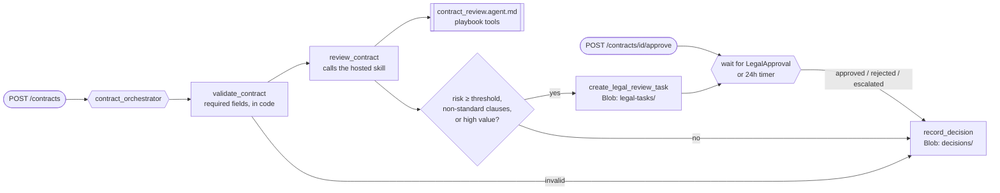

# Contract review (Durable Functions + hosted skill)

A vendor contract is submitted to an HTTP API. A Durable Functions orchestration runs the review process in code: it validates the contract, asks a hosted skill to compare it with Contoso's clause playbook, and then routes it. Low-risk contracts are **auto-approved**. Anything else gets a **legal review task**, and the orchestration waits for a lawyer's decision, escalating if nobody decides within 24 hours. Every outcome is written as an auditable decision record.

This is the [contract review scenario](https://learn.microsoft.com/azure/azure-functions/functions-hosted-skills-scenarios) as a runnable template: `azd up`, submit the sample contracts, approve the risky one, and read the decisions.



## Why this scenario combines a hosted skill with Durable Functions

Contract review needs two different things. Reading clauses written in a counterparty's own words and explaining how they differ from the playbook is judgment, so a hosted skill does it. Deciding who must approve, waiting days for a lawyer, timing out, and keeping an audit trail is process: it has to happen the same way every time, survive restarts, and be explainable later. That part is plain Durable Functions code.

- **The orchestrator owns the process.** Routing rules (risk threshold, non-standard clauses, contract value), the approval wait, the timeout, and the record are code. The model can't skip a step or approve a contract.
- **The skill owns the judgment.** It extracts the terms, calls `check_contract_terms` (deterministic scoring against the playbook), and returns structured JSON: `risk_level`, `risk_score`, `clauses[]`, `deviations[]` with suggested redlines, a `recommendation`, and a `summary`. The response is validated against the skill's `response_schema` before the orchestrator sees it.
- **Replay-safe.** The model call happens in an activity, so its result is checkpointed once and replayed, never re-asked, when the orchestrator resumes.

The three samples show the range:

| Sample | Situation | Expected outcome |
|---|---|---|
| `CTR-2026-0142-standard.json` | SaaS subscription that matches the playbook: 12-month liability cap, net 45, 30-day termination for convenience, renewal increases capped at 5%, mutual indemnity, Washington law, DPA with 72-hour breach notice | `auto_approved` |
| `CTR-2026-0187-nonstandard.json` | Master services agreement with a 3-month cap that covers data incidents while Contoso is uncapped, net 15, no termination for convenience, customer-only indemnity, Texas law, and personal data without a DPA | legal review task, then `approved` by the demo lawyer |
| `CTR-2026-0203-incomplete.json` | Missing counterparty, contract type, date, value, and clauses | `invalid`, never sent to the model |

### How the activity calls the skill

`contract_review.agent.md` has an `http_trigger`, so it is also available as `POST /contract-review` for direct use. The orchestrator doesn't go through HTTP, though. The `review_contract` activity uses `@app.hosted_skill(agent_name="contract_review")` to get the same skill injected as a `HostedSkill` object and calls `skill.run(prompt)` **in-process**:

```python
@bp.activity_trigger(input_name="contract")
@app.hosted_skill(arg_name="skill", agent_name="contract_review")
async def review_contract(contract: dict, skill: HostedSkill) -> dict:
    response = await skill.run(process.review_prompt(contract))
    ...
```

There's no second network hop, no function key to create or store, and no postdeploy hook. The skill's instructions, tools, and response schema are the same either way. If the model returns JSON that doesn't match the schema, `skill.run` raises, and the activity retries up to three times (`REVIEW_RETRY`).

`create_function_app()` returns a regular `func.FunctionApp`, so the Durable Functions triggers live on a `df.Blueprint()` that's registered with `app.register_functions(bp)`.

## Prerequisites

- An Azure subscription with access to a Microsoft Foundry model deployment (the template deploys one).
- [Azure Developer CLI](https://aka.ms/azd) (`azd`) 1.10 or later, and [Azure CLI](https://learn.microsoft.com/cli/azure/install-azure-cli) (`az`). The demo script uses `az` to get the function key.
- Python 3.13.
- For local runs: [Azure Functions Core Tools](https://learn.microsoft.com/azure/azure-functions/functions-run-local) 4.x, [Azurite](https://learn.microsoft.com/azure/storage/common/storage-use-azurite), and Docker for the [Durable Task Scheduler emulator](https://learn.microsoft.com/azure/azure-functions/durable/durable-task-scheduler/develop-with-durable-task-scheduler).

## Deploy to Azure

```bash
git clone https://github.com/Azure-Samples/azure-functions-hosted-skills-samples
cd azure-functions-hosted-skills-samples/contract-review-durable
azd auth login
az login
azd up
```

`azd up` creates a resource group with:

- A Flex Consumption function app with a user-assigned managed identity, running the HTTP API, the orchestration, and the hosted skill.
- A [Durable Task Scheduler](https://learn.microsoft.com/azure/azure-functions/durable/durable-task-scheduler/durable-task-scheduler) (Consumption SKU) with a `contracts` task hub as the Durable Functions backend. The app's identity and your account get the *Durable Task Data Contributor* role.
- A storage account (no shared key access) with the `contract-reviews` container for legal review tasks and decision records.
- A Microsoft Foundry project with a model deployment.
- Application Insights and Log Analytics.

All connections use the managed identity. If the Consumption SKU isn't available in your region, run `azd env set DURABLE_TASK_SCHEDULER_SKU Dedicated` and `azd up` again.

## Try it

```bash
python -m venv .venv
# Windows: .venv\Scripts\activate    macOS/Linux: source .venv/bin/activate
pip install --pre -r requirements-dev.txt

python scripts/demo.py e2e
```

`e2e` submits all three samples, waits for the high-risk contract to reach legal review, approves it as `demo-legal@contoso.com`, waits for every orchestration to finish, and checks each outcome. Example output (from a real run against Azure):

```text
started CTR-2026-0142-standard -> instance 5fe5c1f079e34a5fb42b0e05d6fe80e6
started CTR-2026-0187-nonstandard -> instance e715e07d54e149d4a326b6af4037690c
started CTR-2026-0203-incomplete -> instance fe021277d327492e984463b14ef4e99a

waiting for the high-risk contract to reach legal review...
  legal review task: legal-tasks/e715e07d54e149d4a326b6af4037690c.json
  ! Risk score 100 is at or above the threshold of 40.
  ! The reviewer rated the contract high risk.
  ! Non-standard or missing clauses: limitation_of_liability, payment_terms, termination, indemnification, governing_law, data_protection.
  ! The reviewer recommended legal_review.
approved e715e07d54e149d4a326b6af4037690c as demo-legal@contoso.com

CTR-2026-0142 [5fe5c1f079e34a5fb42b0e05d6fe80e6]: COMPLETED / completed
  outcome: auto_approved (decided by policy)
  risk: low (0), skill recommended approve
  summary: Low risk. The reviewed clauses align with Contoso's SaaS subscription playbook, including liability carve-outs, 45-day payment terms, termination for convenience, compliant renewal terms, mutual indemnities, Washington governing law, and a DPA with 72-hour breach notice.
  record: decisions/5fe5c1f079e34a5fb42b0e05d6fe80e6.json

CTR-2026-0187 [e715e07d54e149d4a326b6af4037690c]: COMPLETED / completed
  outcome: approved (decided by demo-legal@contoso.com)
  risk: high (100), skill recommended legal_review
  - [high] limitation_of_liability: Vendor liability is capped at fees paid in the three months preceding the claim, the cap applies to data security incidents, and Customer's liability is not limited.
  - [low] payment_terms: Customer must pay invoices within 15 days of the invoice date, with late interest at 2% per month.
  - [medium] termination: No termination for convenience is allowed, and fees paid are non-refundable.
  - [high] indemnification: Only Customer indemnifies Vendor for third-party claims arising out of Customer's use of the Services or Customer Data.
  - [medium] governing_law: Texas law applies, with exclusive jurisdiction in Travis County, Texas.
  - [high] data_protection: Vendor processes employee and customer personal data, but no DPA is included and no breach notification timing is stated.
  summary: High risk. The agreement contains multiple material deviations from the playbook, including a three-month liability cap that covers data security incidents, one-sided customer indemnity, no termination for convenience, and processing of personal data without a DPA. Payment terms are also aggressive at net 15 with 2% monthly late interest, and the contract uses Texas law and venue instead of an approved jurisdiction.
  record: decisions/e715e07d54e149d4a326b6af4037690c.json

CTR-2026-0203 [fe021277d327492e984463b14ef4e99a]: COMPLETED / completed
  outcome: invalid (decided by validation)
  x counterparty is required.
  x contract_type must be one of ['master_services', 'saas_subscription'].
  x effective_date must be an ISO date (YYYY-MM-DD).
  x annual_value must be a non-negative number.
  x clauses must be a non-empty list.
  record: decisions/fe021277d327492e984463b14ef4e99a.json
e2e passed
```

To play the lawyer yourself, run the steps one at a time:

```bash
python scripts/demo.py send --sample CTR-2026-0187       # prints the instance ID
python scripts/demo.py status <instance-id>              # stage: awaiting_legal_approval, with reasons and the task
python scripts/demo.py approve <instance-id> --decision rejected --comment "Needs a 12-month cap"
python scripts/demo.py status <instance-id>              # outcome: rejected
```

Use `--file my-contract.json` to submit your own contract in the same shape as the samples.

### HTTP API

All routes use function-level keys in Azure (`x-functions-key` header, or `?code=`). Locally, no key is needed.

| Route | Purpose |
|---|---|
| `POST /contracts` | Start a review. Body: a contract JSON document. Returns `202` with `instanceId`, `statusUrl`, and `approveUrl`. |
| `GET /contracts/{instanceId}` | `runtimeStatus`, the current stage in `customStatus` (`validating`, `reviewing`, `awaiting_legal_approval`, `recording`, `completed`), and the decision in `output` when done. |
| `POST /contracts/{instanceId}/approve` | Body: `{"decision": "approved" \| "rejected", "approver": "...", "comment": "..."}`. Raises the `LegalApproval` event. Returns `409` unless the contract is waiting for legal approval. |
| `POST /contract-review` | Call the hosted skill directly, without the process around it. |

Legal review tasks are written to `legal-tasks/{instanceId}.json` and decision records to `decisions/{instanceId}.json` in the `contract-reviews` container. You can also watch orchestrations in the Durable Task Scheduler dashboard: `azd env get-value DURABLE_TASK_SCHEDULER_DASHBOARD_URL`.

## Run locally

1. Start Azurite and the Durable Task Scheduler emulator:

   ```bash
   azurite
   docker run -d -p 8080:8080 -p 8082:8082 mcr.microsoft.com/dts/dts-emulator:latest
   ```

2. Create the settings file and point it at a Foundry project. After `azd up`, `azd env get-value FOUNDRY_PROJECT_ENDPOINT` prints the endpoint.

   ```bash
   cp src/local.settings.json.sample src/local.settings.json
   # set FOUNDRY_PROJECT_ENDPOINT in src/local.settings.json
   ```

3. Start the app from `src` with the virtual environment active, then run the demo from another terminal:

   ```bash
   cd src && func start --port 7074
   python scripts/demo.py e2e --local
   ```

Locally the app uses your `az login` identity for Foundry, Azurite for the task and decision records, and the emulator's `default` task hub. The emulator dashboard is at http://localhost:8082.

## Make it yours

| To change | Edit |
|---|---|
| Clause playbook, thresholds, scoring | `src/data/clause_playbook.json` and `src/tools/check_contract_terms.py` |
| Approved standard language for redlines | `src/data/standard_terms.json` |
| What the skill looks for and how it explains it | `src/contract_review.agent.md` |
| Routing rules (when a contract needs a lawyer) | `src/contract_process.py` (`legal_review_reasons`) |
| Risk threshold, approval timeout, value threshold | App settings `RISK_THRESHOLD`, `APPROVAL_TIMEOUT_HOURS`, `LEGAL_REVIEW_VALUE_THRESHOLD` (defaults 40, 24, 250000), or the `riskThreshold` and `approvalTimeoutHours` parameters in `infra/main.bicep` |
| Process steps (for example, notify the business owner or escalate to the GC) | `src/contract_orchestration.py` |
| Where tasks and decisions go (CLM system, Teams, ticketing) | `create_legal_review_task` and `record_decision` in `src/function_app.py`, and `src/contract_store.py` |
| Model | `azd env set FOUNDRY_MODEL ...` (and the deployment in `infra/app/foundry.bicep`) |

The policy is read when a review starts and stored in the orchestration input, so changing a setting doesn't affect reviews that are already waiting.

## Guardrails built in

- **The model never decides.** The skill recommends; code auto-approves only when nothing triggers legal review. A score below the threshold, no high risk rating, an `approve` recommendation, and no non-standard or missing clauses are all required, and contracts at or above the value threshold always go to a lawyer.
- **Scoring in code.** `check_contract_terms` compares the extracted terms with the playbook thresholds and computes the score. The skill is told to copy it and may raise the risk level, never lower it.
- **Validated before the model.** `validate_contract` rejects incomplete or oversized contracts and unsafe IDs, so they never reach the skill.
- **Structured, schema-checked output.** The orchestrator only ever sees a review that matches the skill's `response_schema`.
- **Unclear approvals are rejections.** An approval event without a clear `approved` or `rejected` decision is recorded as `rejected`.
- **Nothing waits forever.** A durable timer escalates contracts nobody decides on within `APPROVAL_TIMEOUT_HOURS`.
- **Contract content is data, not instructions.** The skill reports, and never follows, text such as "pre-approved by legal".
- **Auditable.** Every run writes a decision record with the review, the reasons for legal review, who decided, and when. Durable Task Scheduler keeps the orchestration history.
- **No extra reach.** `web_request` and MCP are disabled for this skill; it can only call its three read-only tools.

## Test

From the repository root:

```bash
python scripts/test.py --template contract-review-durable               # Bicep build, skill/tool loading, unit tests
python scripts/test.py --template contract-review-durable --level local # + func start against Azurite and the DTS emulator
python scripts/test.py --template contract-review-durable --level deploy --down  # + azd up, e2e, azd down
```

The unit tests drive the orchestrator with a fake Durable context, covering auto-approval, approval, rejection, timeout escalation, and invalid input, without a model or emulator.

## Troubleshooting

- **`azd up` fails while uploading the package with `403 ... not authorized to perform this operation`.** The app's role assignments were just created and haven't reached Storage yet. Wait a minute and run `azd deploy`.
- **Orchestrations stay `PENDING`.** The app can't reach the task hub. Check `DURABLE_TASK_SCHEDULER_CONNECTION_STRING` and `TASKHUB_NAME`, and that the app's identity has *Durable Task Data Contributor* on the scheduler. Locally, check that the emulator is running on port 8080.
- **A review fails with `HostedSkillResponseError`.** The model returned JSON that didn't match the schema three times in a row. Check the activity's logs in Application Insights.
- **`approve` returns 409.** The orchestration isn't waiting yet (still `reviewing`), was auto-approved, or already finished. Check `GET /contracts/{instanceId}`.

## Clean up

```bash
azd down --purge
```
