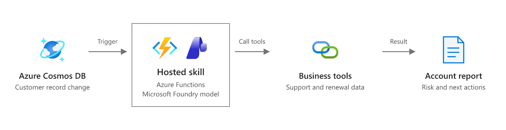

# Customer retention (Cosmos DB change feed hosted skill)

Customer account documents, including usage numbers, live in Azure Cosmos DB. When an account changes, the change feed triggers a hosted skill on Azure Functions. The skill checks the account for churn signals: usage drop, upcoming renewal, open support issues, and unused seats. For accounts that need attention, it drafts a retention action for the customer success manager (CSM): a personalized outreach email and, when it fits, an offer within the tier's policy limits. The draft goes to a separate `retention-actions` container. Offers above the approval threshold are marked `needs_approval`.

This is the [customer retention scenario](https://learn.microsoft.com/azure/azure-functions/functions-hosted-skills-scenarios#respond-to-database-changes) as a runnable template: run `azd up`, seed the sample accounts, lower their usage, and read the drafted actions.



*Scenario overview from [Respond to database changes](https://learn.microsoft.com/azure/azure-functions/functions-hosted-skills-scenarios#respond-to-database-changes) on Microsoft Learn. The diagram below shows how this template implements it.*

```text
 usage job ──► Cosmos DB: retention/accounts ──► change feed ──► customer_retention.agent.md ──► Cosmos DB: retention/retention-actions
                     (app identity: read only)   (leases)         │  hosted skill (Flex Consumption)
                                                                  ├─ assess_churn_signals     (usage change, renewal, tickets, risk - in code)
                                                                  ├─ get_account_profile      (contacts, contract value, usage history)
                                                                  ├─ get_support_tickets      (open problems that explain the drop)
                                                                  ├─ get_plan_catalog         (prices and allowed retention offers)
                                                                  └─ record_retention_action  (policy, approval, idempotency in code)
```

## Why this scenario fits a hosted skill

A usage drop doesn't tell you what to do about it. Losing users because SSO broke after an identity migration calls for a CSM call and a fix. A customer who is asking to remove seats and has a competitor's quote calls for a renewal conversation. The skill reads the account, its usage history, and its tickets, works out the likely cause, and writes an email specific to that cause. The tools do the scoring and enforce the offer policy, so no model output can exceed the discount limit or skip approval.

The samples cover the range:

| Account | Change sent by `demo.py send` | What a CSM would expect |
|---|---|---|
| `ACC-1001` Fabrikam Health (enterprise) | Active users 348 → 128; open sev2 SSO ticket after an identity migration; renews in 45 days | `outreach_only`, about the SSO issue |
| `ACC-1002` Northwind Traders (business) | Active users 68 → 44; asked to remove seats, shared a competitor quote; renews in 21 days | `retention_offer`, either seat rightsizing or a discount within 15% (a discount over 10% needs approval) |
| `ACC-1003` Tailspin Toys (starter) | Active users 12 → 11 | No action (an 8% dip isn't a churn signal) |
| `ACC-1004` Woodgrove Bank (enterprise) | Not changed by `send` (healthy at seed time) | No action |

Account documents and their usage numbers are real Cosmos DB data. The six-month usage history, support tickets, and plan catalog are mock data in `src/data/`. Replace them with your CRM, help desk, and pricing system.

## Prerequisites

- An Azure subscription with access to a Microsoft Foundry model deployment (the template deploys one) and Azure Cosmos DB for NoSQL (serverless).
- [Azure Developer CLI](https://aka.ms/azd) (`azd`) 1.10 or later and [Azure CLI](https://learn.microsoft.com/cli/azure/install-azure-cli) (`az`).
- Python 3.13.
- For local runs: [Azure Functions Core Tools](https://learn.microsoft.com/azure/azure-functions/functions-run-local) 4.x and [Azurite](https://learn.microsoft.com/azure/storage/common/storage-use-azurite).

## Deploy to Azure

```bash
git clone https://github.com/Azure-Samples/azure-functions-hosted-skills-samples
cd azure-functions-hosted-skills-samples/customer-retention-cosmos
azd auth login
az login
azd up
```

`azd up` creates a resource group with:

- A Flex Consumption function app running the hosted skill, with a user-assigned managed identity.
- A serverless Azure Cosmos DB for NoSQL account with key auth disabled (`disableLocalAuth: true`). It contains the `retention` database and three containers: `accounts` (monitored), `leases` (change feed checkpoints), and `retention-actions` (output). All three are created by Bicep. The trigger uses `create_lease_container_if_not_exists: false` because data-plane RBAC can't create containers.
- Cosmos DB data-plane role assignments (`sqlRoleAssignments`):
  - The app's identity gets **Data Reader** on `accounts` and **Data Contributor** on `leases` and `retention-actions`.
  - Your signed-in account gets **Data Contributor** on the account, so `demo.py` and local runs can use your `az login` identity.
- A storage account (no shared key access) for the Functions host, a Microsoft Foundry project with a model deployment, Application Insights, and Log Analytics.

The trigger connects with the managed identity through these app settings: `COSMOS__accountEndpoint`, `COSMOS__credential=managedidentity`, and `COSMOS__clientId`. The tools use the same endpoint.

## Try it

```bash
python -m venv .venv
# Windows: .venv\Scripts\activate    macOS/Linux: source .venv/bin/activate
pip install --pre -r requirements-dev.txt

python scripts/demo.py seed                  # upsert four healthy baseline accounts
python scripts/demo.py send                  # lower usage on ACC-1001, ACC-1002, ACC-1003
python scripts/demo.py results --wait 300    # wait for and print the retention actions
```

Wait about a minute between `seed` and `send` so the baseline change is processed first. If the app's change feed listener is already running, the skill also runs for the seeded accounts and takes no action for them. On a fresh deployment the listener starts reading from the time it first starts, so a seed written before that isn't processed. Use `send --account ACC-1002` to change one account. `python scripts/demo.py e2e` runs seed, send, and wait, then checks each action against the policy: discount within the tier limit, `needs_approval` when required, and a complete email draft. `send` stores the snapshot IDs it wrote in `.last-send.json` (gitignored) for `results`.

Example output (from a real run):

```text
ACC-1001 Fabrikam Health: outreach_only (draft_ready), risk high
  offer: none  value 0 -
  cause: The sharp usage drop is most likely driven by the unresolved SSO sign-in failure after Fabrikam's identity provider migration. Their historical usage was stable until this month, which points to an access issue rather than broad loss of interest.
  email to dana.whitfield@fabrikam.example: Checking in on the SSO sign-in issue at Fabrikam Health

ACC-1002 Northwind Traders: retention_offer (draft_ready), risk high
  offer: seat_rightsizing  value 0 - At renewal, we can reduce your seat count to better match active usage, which lowers your bill without changing plan pricing.
  cause: Northwind appears to be preparing to shrink at renewal due to low adoption and over-purchased seats, with price pressure reinforcing the risk. The steady usage decline, request to remove seats, limited feature adoption, and competitor quote all point to contraction rather than a temporary product issue.
  email to ana.souza@northwind.example: Planning for your upcoming Northwind renewal
```

No action was recorded for ACC-1003 or ACC-1004. Each action is a JSON document in `retention-actions`, partitioned by `account_id`. It holds the decision, risk level, churn signals, likely cause, offer, `status` (`draft_ready` or `needs_approval`, with `approval_reasons`), and the email draft (to, from, subject, body).

Watch the runs in Application Insights, or stream logs with `func azure functionapp logstream <app-name>`.

## Run locally

There's no Cosmos DB emulator step: the change feed trigger needs a real Cosmos DB account. Without one, `func start` still registers the `customer_retention` function, but its listener can't start. The settings sample uses the placeholder `https://localhost:8081/`, and the repository's `local` test level only checks registration. To run end to end on your machine, point the app at the account `azd up` created. Your `az login` identity already has Data Contributor on it.

1. Start Azurite (`azurite`, or `docker run -p 10000-10002:10000-10002 mcr.microsoft.com/azure-storage/azurite`).
2. Create the settings file:

   ```bash
   cp src/local.settings.json.sample src/local.settings.json
   azd env get-value COSMOS_ENDPOINT            # -> COSMOS__accountEndpoint
   azd env get-value FOUNDRY_PROJECT_ENDPOINT   # -> FOUNDRY_PROJECT_ENDPOINT
   ```

   Set both values in `src/local.settings.json`. Leave `COSMOS__credential` unset locally so the trigger and tools use your developer credential (`az login`).

3. Stop the deployed app (`az functionapp stop -g <rg> -n <app>`) so it doesn't share the lease container with your local host. Then start locally and drive it from another terminal:

   ```bash
   cd src && func start
   python scripts/demo.py seed --local
   python scripts/demo.py send --local
   python scripts/demo.py results --local --wait 300
   ```

   You could also use the [Cosmos DB emulator](https://learn.microsoft.com/azure/cosmos-db/emulator), but it needs key auth, and this template is identity-only.

## Make it yours

| To change | Edit |
|---|---|
| How the skill reasons, the offer choice, and the email tone | `src/customer_retention.agent.md` |
| Churn scoring and the "act or not" threshold | `churn_signals` in `src/tools/_policy.py` |
| Discount limits, approval thresholds, success package | `src/data/plans.json` (`retention_policy`), or your pricing system in `get_plan_catalog.py` |
| Usage history and support tickets | `src/tools/get_account_profile.py`, `get_support_tickets.py`: replace the `src/data/*.json` reads with your CRM and help desk |
| Where actions go (CRM task, email draft, Teams) | `src/tools/record_retention_action.py` and `_cosmos.py` |
| Account documents and the monitored container | `samples/accounts.json`, `COSMOS_DATABASE` / `ACCOUNTS_CONTAINER` in `infra/main.bicep` |
| Batch size per invocation | `max_items_per_invocation` in the skill's front matter |
| Model | `azd env set FOUNDRY_MODEL ...` (and the deployment in `infra/app/foundry.bicep`) |

## Guardrails built in

- **Draft, don't act.** The skill writes a draft to `retention-actions`. It never sends email, changes prices, or edits the account; a CSM reviews and sends.
- **No trigger loops.** Output goes to a separate container. The app's identity has only **Data Reader** on the monitored `accounts` container, so it can't write back and retrigger itself.
- **Policy enforced in code.** `record_retention_action` loads the account from Cosmos DB and rejects an offer that's over the tier's `max_discount_percent`, inconsistent with the decision, or not in the catalog. The model gets `rejected_by_policy` and one chance to fix it.
- **Approval enforced in code.** A discount over 10%, or an offer worth over 10,000 a year, gets `status: needs_approval` with the reasons, whatever the model says.
- **Scoring in code.** `assess_churn_signals` computes the usage change, seat utilization, days to renewal, and risk level. The skill only acts when the code says `action_recommended`.
- **Facts from the source.** The email recipient, sender, tier, and contract value come from the account record, not the model.
- **Idempotent.** The action ID is `<account>--<usage snapshot id>`, falling back to the UTC date when there's no snapshot ID, and it's written with create-only semantics. A redelivered change, or a second invocation for the same usage update, returns `duplicate`. A new usage snapshot can produce a new action.
- **Account and ticket text is data, not instructions.**
- **No extra reach.** `web_request` and MCP are disabled; the skill can call only its five tools.

The change feed checkpoint advances even if an invocation fails, so a failed run isn't retried automatically. Rerun `send` for the account (it writes a new snapshot), or reset the lease container to replay.

## Test

From the repository root:

```bash
python scripts/test.py --template customer-retention-cosmos                          # Bicep build, skill/tool loading, unit tests
python scripts/test.py --template customer-retention-cosmos --level local --port 7072  # + func start registers the trigger (no Cosmos needed)
python scripts/test.py --template customer-retention-cosmos --level deploy --down     # + azd up, demo e2e, azd down
```

## Troubleshooting

- **`azd up` fails while uploading the package with `403 ... not authorized to perform this operation`.** The app's role assignments haven't propagated to Storage yet. Wait a minute and run `azd deploy`.
- **Provisioning fails because Cosmos DB has no capacity in the region.** Serverless capacity varies by region. Run `azd env set AZURE_LOCATION <region>` and `azd up` again.
- **`send` produces no actions.** The trigger only sees changes made after its lease was created. Check that the function started (Application Insights traces show `Registered trigger ... cosmos_db_trigger`), then run `send` again. A `Forbidden` (403, substatus 5301) error in the logs means a data-plane role assignment is missing or still propagating.
- **`demo.py` fails with `Forbidden` locally.** Your account needs the Cosmos DB data-plane role. `azd up` grants it to the signed-in principal, so run `azd up` again after `az login` with the same account.

## Clean up

```bash
azd down --purge
```
