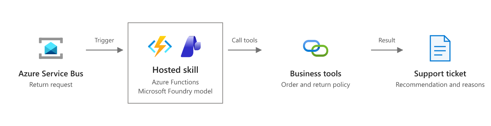

# Customer returns triage (queue-triggered hosted skill)

A return request lands on a queue. A hosted skill on Azure Functions reads it, looks up the order, the return policy, and the customer's support history, then records a recommendation — **approve**, **approve as an exception**, **decline**, or **escalate** — with its reasons, evidence, and a reply draft for a support agent to send.

This is the [customer returns scenario](https://learn.microsoft.com/azure/azure-functions/functions-hosted-skills-scenarios#process-customer-requests-from-messages) as a runnable template: `azd up`, send the sample requests, and read the recommendations.



*Scenario overview from [Process customer requests from messages](https://learn.microsoft.com/azure/azure-functions/functions-hosted-skills-scenarios#process-customer-requests-from-messages) on Microsoft Learn. The diagram below shows how this template implements it.*

```text
 return request ──► Storage queue ─┐
   (JSON)           or Service Bus ┴─► customer_returns.agent.md ──► Blob: return-recommendations/{request_id}.json
                                         │  hosted skill (Flex Consumption)
                                         ├─ get_order            (days since delivery, computed in code)
                                         ├─ get_return_policy    (window + exceptions)
                                         ├─ get_support_history  (tickets, account flags)
                                         └─ record_return_recommendation (idempotent, approval rule enforced in code)
```

## Why this scenario fits a hosted skill

Return requests rarely fit the rule exactly. "It's past 30 days, but it arrived broken and I emailed you right away" needs someone to read the message, find the ticket, and apply the policy's exception. The hosted skill does that judgment; the tools keep the facts and the side effects deterministic.

The three samples show the range:

| Sample | Situation | What a reviewer would expect |
|---|---|---|
| `RR-1001` | 48 days after delivery, but damage was reported on day 2 (ticket T-2207) | `approve_exception` (policy OG-EX-1), replacement, needs approval |
| `RR-1002` | 11 days, tags still on | `approve_standard`, refund |
| `RR-1003` | 72 days, "defective", but a ticket shows the stove was used and the account is flagged | `decline` or `escalate`, needs approval |

## Prerequisites

- An Azure subscription with access to a Microsoft Foundry model deployment (the template deploys one).
- [Azure Developer CLI](https://aka.ms/azd) (`azd`) 1.10 or later, and [Azure CLI](https://learn.microsoft.com/cli/azure/install-azure-cli) (`az`).
- Python 3.13.
- For local runs: [Azure Functions Core Tools](https://learn.microsoft.com/azure/azure-functions/functions-run-local) 4.x and [Azurite](https://learn.microsoft.com/azure/storage/common/storage-use-azurite).

## Deploy to Azure

```bash
git clone https://github.com/Azure-Samples/azure-functions-hosted-skills-samples
cd azure-functions-hosted-skills-samples/customer-returns-queue
azd auth login
azd up
```

`azd up` creates a resource group with:

- A Flex Consumption function app running the hosted skill, with a user-assigned managed identity.
- A storage account (no shared key access) for the app, the `customer-returns` queue, and the `return-recommendations` container.
- A Microsoft Foundry project with a model deployment.
- Application Insights and Log Analytics.

All connections use the managed identity. Your signed-in account also gets data-plane roles so you can run the demo and the app locally.

### Use Service Bus instead of a Storage queue

```bash
azd env set QUEUE_PROVIDER servicebus
azd up
```

This adds a Service Bus namespace (Basic tier, Entra ID only) with a `customer-returns` queue and switches the hosted skill's trigger to `service_bus_queue_trigger`. Nothing else changes: the trigger type and connection come from app settings that the skill file reads as `$RETURNS_TRIGGER_TYPE` and `RETURNS_QUEUE_CONNECTION`.

## Try it

```bash
python -m venv .venv
# Windows: .venv\Scripts\activate    macOS/Linux: source .venv/bin/activate
pip install --pre -r requirements-dev.txt

python scripts/demo.py send               # send all three samples
python scripts/demo.py results --wait 300 # wait for and print the recommendations
```

Example output:

```text
RR-1001: approve_exception / replacement (needs approval)
  - Return requested 48 days after delivery, outside the 30-day window.
  - Damage was reported 2 days after delivery (T-2207), so exception OG-EX-1 applies.
```

Each recommendation is a JSON document in the `return-recommendations` container. Send one sample with `--sample RR-1003`. `python scripts/demo.py e2e` sends uniquely named copies and checks that each one was recorded with reasons and the approval rule.

Watch the run in Application Insights, or stream logs with `func azure functionapp logstream <app-name>`.

## Run locally

1. Start Azurite (`azurite`, or `docker run -p 10000-10002:10000-10002 mcr.microsoft.com/azure-storage/azurite`).
2. Create the settings file and point it at a Foundry project. After `azd up`, `azd env get-value FOUNDRY_PROJECT_ENDPOINT` prints the endpoint.

   ```bash
   cp src/local.settings.json.sample src/local.settings.json
   # set FOUNDRY_PROJECT_ENDPOINT in src/local.settings.json
   ```

3. Start the app from `src` with the virtual environment active, then send messages to Azurite from another terminal:

   ```bash
   cd src && func start
   python scripts/demo.py send --local
   python scripts/demo.py results --local --wait 300
   ```

Locally the app uses your `az login` identity for Foundry.

## Make it yours

| To change | Edit |
|---|---|
| Decision rules, tone, escalation criteria | `src/customer_returns.agent.md` |
| Order, policy, and CRM lookups | `src/tools/get_*.py` — replace the `src/data/*.json` reads with calls to your systems |
| Where recommendations go (ticketing system, Teams, Cosmos DB) | `src/tools/record_return_recommendation.py` and `_recommendation_store.py` |
| Model | `azd env set FOUNDRY_MODEL ...` (and the deployment in `infra/app/foundry.bicep`) |
| Queue technology | `azd env set QUEUE_PROVIDER storage|servicebus` |

## Guardrails built in

- **Recommend, don't act.** The skill records a recommendation. Refunds and replacements stay in your order system behind its own approval flow.
- **Approval enforced in code.** `record_return_recommendation` forces `requires_human_approval` for every decision other than `approve_standard`, whatever the model says.
- **Idempotent.** Queue messages can be delivered more than once. The recommendation is written with `overwrite=False`; a retry returns `duplicate` instead of a second write.
- **Facts from code.** `days_since_delivery` is calculated by `get_order`, not by the model.
- **No extra reach.** `web_request` and MCP are disabled for this skill; it can only call its four tools.
- **Poison messages.** After 5 failed attempts the message moves to `customer-returns-poison` (Storage) or the dead-letter queue (Service Bus).

## Test

From the repository root:

```bash
python scripts/test.py --template customer-returns-queue               # Bicep build, skill/tool loading, unit tests
python scripts/test.py --template customer-returns-queue --level local # + func start against Azurite
python scripts/test.py --template customer-returns-queue --level deploy --down  # + azd up, e2e, azd down
```

## Troubleshooting

- **`azd up` fails while uploading the package with `403 ... not authorized to perform this operation`.** The app's role assignments were just created and haven't reached Storage yet. Wait a minute and run `azd deploy`.
- **No recommendations appear.** Check the function's logs in Application Insights. Messages that fail 5 times move to `customer-returns-poison` (Storage) or the dead-letter queue (Service Bus).

## Clean up

```bash
azd down --purge
```
