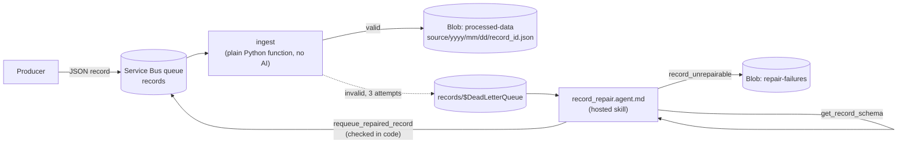

# Record repair on a Service Bus dead-letter queue (hosted skill added to an existing pipeline)

An ingestion pipeline already exists: a plain Azure Function, `ingest`, reads JSON records from a Service Bus queue, validates them against a schema, and writes them to Blob Storage. Records that don't match the schema fail and, after a few attempts, land in the queue's **dead-letter queue**, where they usually wait for a person.

This template adds AI to that pipeline without touching the deterministic path. A hosted skill listens on the dead-letter queue, fixes **format-only** mistakes (`recordId` → `record_id`, `"21.5"` → `21.5`, `Value` → `value`), and sends the corrected record back to the main queue, so the original `ingest` function processes it again. Records that would need guessing — a missing measurement, for example — are written to a `repair-failures` container for a person to review.

This is the [add AI to an existing workflow scenario](https://learn.microsoft.com/azure/azure-functions/functions-hosted-skills-scenarios#add-ai-to-an-existing-workflow) as a runnable template. It is a simplified version of [hosted-skills-delivery-recovery](https://github.com/greenie-msft/hosted-skills-delivery-recovery), which also shows a browser UI and Connector Namespace MCP connectors.



## Why this scenario fits a hosted skill

Schema rules are easy to check in code, but fixing a bad record means reading it the way a person would: "`recordId` is obviously `record_id`, and `"21.5"` is a number, but there is no `value` at all, so I can't fix that." The hosted skill does that reading. The pipeline itself stays deterministic: the skill never writes output; it only puts a corrected record back on the queue, and `ingest` decides again.

| Sample | Record | Expected outcome |
|---|---|---|
| `01-valid` | `{"record_id": "rec-valid", "source": " Partner Feed ", "value": 21.5}` | `ingest` writes it on the first try (`source` normalized to `partner-feed`) |
| `02-renamed-field` | `recordId` instead of `record_id`, `value` as the string `"21.5"` | Dead-lettered → repaired → ingested with `repaired: true` |
| `03-wrong-casing` | `Source` and `Value` instead of `source` and `value` | Dead-lettered → repaired → ingested with `repaired: true` |
| `04-missing-value` | No `value` field | Dead-lettered → **not** repaired → `repair-failures/<message-id>.json` |

### What's real and what's sample data

Everything runs on real Azure services: Service Bus (Standard), Blob Storage, a Microsoft Foundry model, and a Flex Consumption function app. Only the records are synthetic. The schema is `src/record-schema.json`.

## Prerequisites

- An Azure subscription with access to a Microsoft Foundry model deployment (the template deploys one).
- [Azure Developer CLI](https://aka.ms/azd) (`azd`) 1.10 or later, and [Azure CLI](https://learn.microsoft.com/cli/azure/install-azure-cli) (`az`).
- Python 3.13.
- For local runs: [Azure Functions Core Tools](https://learn.microsoft.com/azure/azure-functions/functions-run-local) 4.x and [Azurite](https://learn.microsoft.com/azure/storage/common/storage-use-azurite).

## Deploy to Azure

```bash
git clone https://github.com/Azure-Samples/azure-functions-hosted-skills-samples
cd azure-functions-hosted-skills-samples/record-repair-servicebus
azd auth login
azd up
```

`azd up` creates a resource group with:

- A Flex Consumption function app with a user-assigned managed identity. It hosts both the `ingest` function and the `record_repair` hosted skill.
- A Service Bus namespace (Standard tier, Entra ID only) with two queues: `records` for the deployed app and `records-local` for `func start`. Both have `maxDeliveryCount` 3, dead-lettering, and duplicate detection (1 hour window).
- A storage account (no shared key access) with the `processed-data` and `repair-failures` containers.
- A Microsoft Foundry project with a model deployment.
- Application Insights and Log Analytics.

The app's identity gets Service Bus Data Receiver and Sender and Storage Blob Data Owner. Your signed-in account gets Service Bus Data Receiver and Sender, Storage Blob Data Contributor, and Foundry access, so you can run the demo and the app locally.

## Try it

```bash
python -m venv .venv
# Windows: .venv\Scripts\activate    macOS/Linux: source .venv/bin/activate
pip install --pre -r requirements-dev.txt

python scripts/demo.py send       # send the four samples (each run gets fresh record IDs)
python scripts/demo.py results    # list processed-data, repair-failures, and the dead-letter count
python scripts/demo.py e2e        # send, wait (up to 10 minutes), and check every outcome
```

A repaired record takes a minute or two: `ingest` has to fail it three times before Service Bus dead-letters it, then the skill runs. Send a single sample with `python scripts/demo.py send --sample 02-renamed-field`.

Example output from a deployed run (`python scripts/demo.py e2e`; the last line is from a following `results`):

```text
sent rec-valid-dd322a             {"record_id": "rec-valid-dd322a", "source": " Partner Feed ", "value": 21.5}
sent rec-renamed-dd322a           {"recordId": "rec-renamed-dd322a", "source": " Partner Feed ", "value": "21.5"}
sent rec-casing-dd322a            {"record_id": "rec-casing-dd322a", "Source": "Field Sensors", "Value": 18}
sent rec-missing-dd322a           {"record_id": "rec-missing-dd322a", "source": "Field Sensors"}
-> Service Bus queue 'records' on sb-<token>.servicebus.windows.net
waiting... 0/4 records settled
waiting... 1/4 records settled
processed-data (3):
  rec-casing-dd322a            source=field-sensors  value=18     REPAIRED (renamed Source to source; renamed Value to value)
  rec-renamed-dd322a           source=partner-feed   value=21.5   REPAIRED (renamed recordId to record_id; converted value from string to number)
  rec-valid-dd322a             source=partner-feed   value=21.5   ingested
repair-failures (1):
  rec-missing-dd322a           required field 'value' is missing and cannot be repaired without guessing
e2e passed

dead-letter queue 'records/$DeadLetterQueue': 0 message(s)
```

The repaired record `processed-data/partner-feed/2026/11/13/rec-renamed-dd322a.json` has the normal output shape, plus a note on how it was repaired:

```json
{
  "record_id": "rec-renamed-dd322a",
  "source": "partner-feed",
  "value": 21.5,
  "ingested_at": "2026-11-13T06:54:02.304313+00:00",
  "schema_version": 1,
  "repaired": true,
  "repair_changes": "renamed recordId to record_id; converted value from string to number"
}
```

The unrepairable one, `repair-failures/rec-missing-dd322a.json`:

```json
{
  "message_id": "rec-missing-dd322a",
  "record_id": "rec-missing-dd322a",
  "reason": "required field 'value' is missing and cannot be repaired without guessing",
  "original_body": "{\"record_id\": \"rec-missing-dd322a\", \"source\": \"Field Sensors\"}",
  "truncated": false,
  "recorded_at": "2026-11-13T06:54:01.493995+00:00"
}
```

Watch the runs in Application Insights, or stream logs with `func azure functionapp logstream <app-name>`.

## Run locally

There is no Service Bus emulator in this setup, so a local run uses the deployed namespace with your `az login` identity, on its own `records-local` queue so it doesn't compete with the deployed app. Blob output goes to Azurite. Run `azd up` first.

1. Start Azurite (`azurite`, or `docker run -p 10000-10002:10000-10002 mcr.microsoft.com/azure-storage/azurite`).
2. Create the settings file and fill in the two values from your azd environment:

   ```bash
   cp src/local.settings.json.sample src/local.settings.json
   azd env get-value SERVICEBUS_FULLY_QUALIFIED_NAMESPACE   # -> ServiceBusConnection__fullyQualifiedNamespace
   azd env get-value FOUNDRY_PROJECT_ENDPOINT               # -> FOUNDRY_PROJECT_ENDPOINT
   ```

3. Start the app from `src` with the virtual environment active, then run the demo against it from another terminal:

   ```bash
   cd src && func start
   python scripts/demo.py e2e --local
   ```

`--local` reads `src/local.settings.json`, sends to `records-local`, and reads results from Azurite.

## Make it yours

| To change | Edit |
|---|---|
| The record format | `src/record-schema.json` (the `ingest` function, the tools, and the skill all read it) |
| What `ingest` does with a valid record | `src/function_app.py` and `src/ingestion/records.py` (`build_output`) |
| Which repairs are allowed | The prompt in `src/record_repair.agent.md` **and** `format_only_problems` in `src/ingestion/records.py`, which enforces them |
| Where unrepairable records go (ticket, Teams, a review queue) | `src/tools/record_unrepairable.py` |
| Retries before dead-lettering | `maxDeliveryCount` in `infra/main.bicep` |
| Model | `azd env set FOUNDRY_MODEL ...` (and the deployment in `infra/app/foundry.bicep`) |

To add the skill to your own pipeline, deploy `record_repair.agent.md` and `src/tools/` next to your existing function and point `INGEST_QUEUE` and `ServiceBusConnection` at your queue.

## Guardrails built in

The prompt asks for the right behavior; the tools enforce it in code, whatever the model does:

- **Repairs go back through the original path.** The skill never writes to `processed-data`. `requeue_repaired_record` sends the corrected record to the main queue, and `ingest` validates it again.
- **Schema checked before requeue.** The corrected record must pass `record-schema.json`, or the tool returns `rejected`.
- **Format-only, checked in code.** The tool compares the corrected record with the original body: field names may differ only by case, `_`, or `-`, and a numeric string may become the same number. Added, dropped, or changed values are rejected, so a model can't invent a missing `value`.
- **One repair per record.** The tool refuses messages whose ID starts with `repair-`, and the skill also checks for the `repaired` application property. A repaired record that fails again is dead-lettered once more and recorded as unrepairable instead of looping.
- **Idempotent.** Requeued messages use message ID `repair-<original-id>`, and the queue has duplicate detection, so a retried skill run can't enqueue a second copy. `ingest` and `record_unrepairable` write blobs with `overwrite=False`.
- **Bodies are data.** The skill is told to ignore instructions inside records. `web_request` and MCP are disabled; it can only call its three tools.

Known limitations:

- The tool trusts the `original_body` the model passes in. A model could pass a different body; the schema check and the `repair-` loop guard still apply.
- If a skill run itself fails (for example, the model is unavailable), the message is returned to the dead-letter queue and retried; a dead-letter queue has no further dead-lettering.

## Test

From the repository root:

```bash
python scripts/test.py --template record-repair-servicebus               # Bicep build, skill/tool loading, unit tests
python scripts/test.py --template record-repair-servicebus --level local # + func start (functions must register)
python scripts/test.py --template record-repair-servicebus --level deploy --down  # + azd up, e2e, azd down
```

## Troubleshooting

- **`azd up` fails while uploading the package with `403 ... not authorized to perform this operation`.** The app's role assignments were just created and haven't reached Storage yet. Wait a minute and run `azd deploy`.
- **`demo.py` fails with `Unauthorized` on Service Bus.** New role assignments can take a few minutes. Make sure you're signed in to `az` as the account that ran `azd up`.
- **A repairable record stays in the dead-letter queue.** Check the `record_repair` function in Application Insights. `python scripts/demo.py results` shows the dead-letter count.
- **Local `func start` receives nothing.** Check that `ServiceBusConnection__fullyQualifiedNamespace` and `INGEST_QUEUE` (`records-local`) are set in `src/local.settings.json`.

## Clean up

```bash
azd down --purge
```
