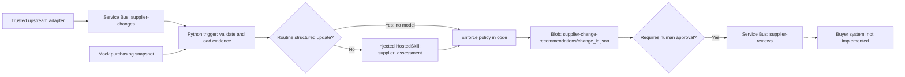

<!--
---
name: "Azure Functions hosted skills: Supplier change assessment"
description: Assess supplier delivery changes from Azure Service Bus with a hosted skill, code-enforced purchasing policy, and buyer-review notifications.
page_type: sample
languages:
- python
- bicep
- azdeveloper
products:
- azure
- azure-functions
urlFragment: ai-hosted-skills-supplier-change-servicebus-python
---
-->

# Supplier change assessment (Service Bus + Hosted Skill binding)

A supplier reports a changed delivery date, partial shipment, or proposed substitute. Application code validates the message, loads purchasing evidence, and decides whether a model is needed. A routine structured schedule confirmation stays in code; an ambiguous exception calls a Markdown-defined Hosted Skill. Code enforces purchasing policy, stores a recommendation, and sends a reference-only buyer-review notification when approval is required.

**This is a recommendation workflow, not an order-management system.** It never writes purchase orders, approves a substitute, or communicates with suppliers. The buyer-review queue has **no downstream consumer in this sample**.



## Why this scenario fits a Hosted Skill

“Early next week, subject to inspection” is not a confirmed date. “Should be equivalent” is not a compatibility certification. A model can explain those uncertainties and propose questions; it should not calculate inventory facts or authorize purchases. Here the application owns the process and calls `skill.run()` only for the judgment step through `@app.hosted_skill()`.

The [agent definition](src/supplier_assessment.agent.md) has **no trigger, public HTTP endpoint, chat endpoint, or MCP endpoint**. The only business trigger is the Python Service Bus handler in [the application](src/function_app.py). The skill has no tools, MCP servers, reusable skills, or web access.

| Sample | Situation | Deterministic final decision | `used_skill` | Human approval |
|---|---|---|---|---|
| `SC-1001` | All 100 bearings confirmed for November 21; within required date and coverage, no substitute | `accept_update` | `false` | No |
| `SC-1002` | Only 80 of 200 seals available; remaining date unconfirmed | `buyer_review` | `true` | Yes: missing date and 120-unit shortfall |
| `SC-1003` | 50 replacement valves proposed on time, but `VALVE-X` is not approved | `buyer_review` | `true` | Yes: unapproved substitute, even if the model recommends acceptance |

Model summaries, reasons, questions, and `model_recommendation` may vary. These final decisions are deterministic because code overrides model output when policy reasons exist.

### Evidence and trust boundary

[Purchasing data](src/data/purchasing.json) is a **mock, fixed November 2026 snapshot**, not live inventory, a current-date calculation, or an ERP integration. Code computes `shortfall_units`, `inventory_gap_days`, `after_required_date`, and `substitution_approved`, then snapshots the purchase order, inventory, policy, and facts into each record. The inventory gap is the days **before replenishment arrives**, relative to `coverage_until`; it is not a net-quantity inventory projection after replenishment. A missing delivery date yields an unknown gap, not a proven zero gap.

The no-model fast path accepts only canonical, validated `schedule_update` messages with a confirmed date, full outstanding quantity, no substitution, and no policy exception. The **upstream system must be trusted to normalize and validate schema, dates, and quantities and to classify the change correctly**. Free-text `explanation` is informational on this path: it is not interpreted for contradictions. Do not feed unnormalized supplier emails into this fast path; classify uncertain or contradictory reports as `exception` upstream. Structural validation is not authentication or proof that a supplier's claims are true.

## Prerequisites

- An Azure subscription with permission to deploy resources and assign roles, plus model availability and quota for the default Foundry `gpt-5.4` deployment in a supported region.
- [Azure Developer CLI](https://aka.ms/azd) 1.10+ and [Azure CLI](https://learn.microsoft.com/cli/azure/install-azure-cli).
- Python 3.13 and a virtual environment.
- For local hosting: [Azure Functions Core Tools](https://learn.microsoft.com/azure/azure-functions/functions-run-local) 4.x and [Azurite](https://learn.microsoft.com/azure/storage/common/storage-use-azurite).
- **A real Azure Service Bus namespace and both queues, including for local runs. Azurite emulates Blob storage here, not Service Bus.** The easiest setup is to provision this sample first.

## Deploy to Azure

From this sample folder:

```bash
azd auth login
az login
azd up
```

The [infrastructure](infra/main.bicep) creates:

- A Python 3.13 Azure Functions Flex Consumption app with a user-assigned managed identity.
- An Entra-only Basic Service Bus namespace with `supplier-changes` and `supplier-reviews` queues, five-minute locks, and `maxDeliveryCount: 5`.
- A storage account with shared-key access disabled and the `supplier-change-recommendations` container.
- A Microsoft Foundry project and model deployment, Application Insights, and Log Analytics.
- Data-plane access for the app identity and deploying user: Service Bus send/receive, Blob access, and Foundry access as configured in the infrastructure.

Azure-hosted SDK clients use managed identity through `DefaultAzureCredential`; no cloud storage keys or Service Bus connection strings are required. The demo on a developer machine can use the Azure CLI login through the default credential chain. `azd auth login` alone does not establish an Azure CLI SDK login.

### Demo environment contract

The demo reads the selected sample's `azd env get-values` output (run it from this folder):

| Output | Purpose |
|---|---|
| `SERVICEBUS_FULLY_QUALIFIED_NAMESPACE` | Send to the deployed Service Bus namespace |
| `SERVICEBUS_QUEUE_NAME` | Input queue: `supplier-changes` |
| `SERVICEBUS_REVIEW_QUEUE_NAME` | Buyer notification queue: `supplier-reviews` (not consumed by the demo) |
| `RECOMMENDATIONS_CONTAINER` | Recommendation blob container |
| `AZURE_STORAGE_ACCOUNT_NAME` | Identity-authenticated blob reads |

The application itself uses `SERVICEBUS__fullyQualifiedNamespace` for the Functions trigger and `SUPPLIER_SERVICEBUS_NAMESPACE` for notification SDK calls. The infrastructure supplies these; these app settings are not alternate demo output names. Queue names are fixed in the application, not configurable through the demo.

## Try it

Create and activate a virtual environment, then install dependencies:

```bash
python -m venv .venv
# Windows: .venv\Scripts\activate    macOS/Linux: source .venv/bin/activate
pip install --pre -r requirements-dev.txt

python scripts/demo.py send
python scripts/demo.py results --wait 300
python scripts/demo.py send --sample SC-1003
python scripts/demo.py e2e
```

`send` sends the JSON samples with `message_id` equal to `change_id`. `results` reads the three original sample IDs by default; `--wait` polls **those exact blob names**, never unrelated blobs. Missing results return a nonzero exit code. To inspect an e2e run, use the unique IDs printed by `send`:

```bash
python scripts/demo.py results --id SC-1001-<run-id> --id SC-1002-<run-id> --wait 300
```

Replace the bracketed run ID before executing. A record is stored as `<change_id>.json` and includes `decision`, `used_skill`, `requires_human_approval`, model assessment text, deterministic policy reasons and facts, purchasing evidence, and an `input_fingerprint`.

`e2e` sends unique `SC-1001-<id>`, `SC-1002-<id>`, and `SC-1003-<id>` copies, then checks:

- All exact IDs exist and match input `change_id`, `po_id`, `supplier_id`, and the input fingerprint.
- Final decisions are `accept_update` / `buyer_review` / `buyer_review`; skill flags are `false` / `true` / `true`; approval flags are `false` / `true` / `true`.
- Reasons and summaries exist, deterministic policy reasons are correct, and computed facts and the purchasing snapshot match the supplied input and fixture data.

**E2e verifies blob records only, not buyer-notification delivery.** The blob is committed before the notification is sent; a successful blob check cannot prove the notification succeeded or the trigger completed. The demo neither receives review messages nor resends IDs as purported proof of no overwrite. Use application logs and separate delivery tests for notification/retry behavior.

## Run locally

1. Provision the Azure resources above, or supply an equivalent Service Bus namespace, both queues, a Foundry project/model, and the required Entra data roles. Use `az login` for the identity used by local SDK calls.
2. Start Azurite (for local Blob/host storage only), and create [local settings](src/local.settings.json.sample):

   ```bash
   azurite
   # In another terminal, from this sample folder:
   cp src/local.settings.json.sample src/local.settings.json
   azd env get-value SERVICEBUS_FULLY_QUALIFIED_NAMESPACE
   azd env get-value FOUNDRY_PROJECT_ENDPOINT
   azd env get-value FOUNDRY_MODEL
   ```

3. Edit the new local settings file:
   - Keep `AzureWebJobsStorage` as `UseDevelopmentStorage=true` for Azurite blobs.
   - Set **both** `SERVICEBUS__fullyQualifiedNamespace` (input) and `SUPPLIER_SERVICEBUS_NAMESPACE` (output) to the same real `name.servicebus.windows.net` namespace.
   - Set `FOUNDRY_PROJECT_ENDPOINT` and `FOUNDRY_MODEL` to the provisioned values.
   - Keep `RECOMMENDATIONS_CONTAINER` as `supplier-change-recommendations`.
   - Do not copy deployed managed-identity-only connection settings into local configuration.
4. With the virtual environment active, start the host:

   ```bash
   cd src
   func start
   ```

5. In another terminal, from the sample folder with the same virtual environment active:

   ```bash
   python scripts/demo.py send --local
   python scripts/demo.py results --local --wait 300
   python scripts/demo.py e2e --local --timeout 600
   ```

The demo reads the local settings file, falling back to the checked-in template when it is absent. `send --local` and `e2e --local` reject missing, placeholder, or mismatched namespaces before sending. `results --local` needs only Blob configuration and works without Service Bus settings. Local demo Service Bus credentials explicitly use `AzureCliCredential`; local app clients use `DefaultAzureCredential` with your developer login. Azurite uses its emulator connection rather than cloud credentials.

**Do not run the deployed host and local host against the same input queue simultaneously.** They are competing consumers: a message might be handled in Azure and stored in cloud blobs while the local demo waits in Azurite. Stop the other host or provision a separate development environment. Local runs still incur real Service Bus and Foundry usage charges.

## Reliability and approval guardrails

- **First committed recommendation wins.** [The store](src/supplier_store.py) writes with `overwrite=False`. A concurrent write reads the winning stored record, and [the handler](src/function_app.py) verifies the input fingerprint before proceeding. Reusing an ID with a changed payload is rejected; use a new `change_id` for a new event.
- **Retries reuse persisted decisions.** Once a record exists, a replay checks its fingerprint and skips the model. Concurrent deliveries arriving **before the first commit can still make multiple model calls**; the blob write prevents replacement, not duplicate computation.
- **Notification failures retry.** Buyer notifications are sent after persistence, on every replay that requires approval. Send errors propagate to the Functions host. A retry reuses the saved recommendation and attempts notification again. After the configured delivery limit, failed input messages go to the Service Bus dead-letter queue for operator investigation; this is not guaranteed eventual notification delivery.
- **At-least-once, not exactly-once.** A crash after sending but before completion can produce duplicate review messages. A future downstream consumer must deduplicate by `change_id`; Service Bus `message_id` alone is not a deduplication guarantee for this Basic-tier sample.
- **Reference-only notification.** The `supplier-reviews` JSON contains only `change_id`, `po_id`, `decision`, and `recommendation_blob` (the blob name). No supplier prose or model-generated text is copied to that queue. No buyer consumer, approval UI, or supplier communication is implemented.
- **Code enforces approval.** Missing dates, quantity mismatches, coverage gaps, late dates, and unapproved substitutes force `buyer_review`, even if the model says `accept_update`. Other non-accept decisions also require human approval.
- **Invalid inputs fail closed.** Malformed JSON, missing/unknown fields, invalid IDs/dates/quantities, unknown orders, and supplier/order mismatches fail processing rather than creating a fabricated recommendation. Investigate dead-lettered messages instead of assuming every input creates a blob.

## Security and privacy

Supplier explanations are untrusted data. The agent instructions prohibit following embedded instructions or inventing approvals. Structured response validation and deterministic policy enforcement constrain the result, but are not a complete prompt-injection defense. Keep authorization at the upstream adapter and code-controlled action boundary.

Input explanations and purchasing context are sent to the configured Foundry model for exception cases. Blobs retain model-generated summaries/reasons/questions plus supplier/order IDs and a purchasing snapshot; reference-only notifications reduce propagation but are **not anonymization**. Use synthetic data for this demo. For production, review model data handling, minimize/redact sensitive inputs, scope RBAC per queue/container, restrict networking, set retention/deletion policies for blobs and telemetry, and review logs before enabling verbose prompt capture. The infrastructure disables shared-key/local authentication for cloud Storage and Service Bus, but allows public network access; private networking is not supplied here. Never commit credentials or local settings containing secrets.

## Make it yours

| To change | Edit |
|---|---|
| Assessment language, ambiguity handling, questions | [Agent instructions and response schema](src/supplier_assessment.agent.md) |
| Canonical message validation, fast path, computed facts, policy | [Process module](src/supplier_process.py) |
| Mock purchasing/inventory lookups | [Snapshot](src/data/purchasing.json) and [context loader](src/supplier_process.py); replace with authenticated APIs |
| Invocation sequencing and skill binding | [Python handler](src/function_app.py) |
| Persistence and reference notification | [Store](src/supplier_store.py); add a separately secured buyer consumer |
| Model deployment | [Infrastructure](infra/main.bicep) and [Foundry module](infra/app/foundry.bicep) |

## Test

From this sample folder, with development requirements installed:

```bash
python -m pytest tests/test_demo.py -q
python -m pytest tests -q
```

[Demo unit tests](tests/test_demo.py) use actual JSON fixtures and pure process code, and mock SDK boundaries. They require no Azure resources or credentials. They check sample parsing, exact-input correlation, missing/wrong decisions, skill and approval flags, evidence/policy mismatches, namespace validation, and exact-ID polling. For a live smoke test, run `python scripts/demo.py e2e` against the deployment or add `--local` against the local host. Offline tests do not establish live deployment or notification-delivery success.

Handler, process, and storage tests also verify real binding indexing, no-model
routing, policy overrides, invalid inputs, response schema, concurrent writes, and
notification-failure replay without another model call.

From the repository root, use the shared cumulative checks:

```bash
python scripts/test.py --template supplier-change-servicebus
python scripts/test.py --template supplier-change-servicebus --level local
python scripts/test.py --template supplier-change-servicebus --level deploy --down
```

The default performs Bicep/config loading and offline unit tests. The local level
adds host startup and requires configured real Service Bus and Foundry access.
The deploy level creates billable resources and runs the blob-only smoke check.

## Troubleshooting

- **Namespace validation fails:** replace both local placeholders with the same real fully qualified namespace. Neither `UseDevelopmentStorage=true` nor a Service Bus connection string is a namespace. Ensure the selected azd environment belongs to this sample.
- **403 or authorization failure:** check Azure CLI login and Service Bus sender/receiver, Blob, and Foundry data roles. Newly assigned roles may need time to propagate. For a deployment-package upload denied immediately after provisioning, retry `azd deploy` after propagation; do not enable shared keys to work around RBAC.
- **No local results:** confirm Azurite and the local host are running, the namespace matches, and the deployed host is not consuming the same queue. Local results are not cloud results.
- **Blob exists but no review notification:** the blob is written first. Check Application Insights/host logs, retries, and the input queue's dead-letter subqueue. E2e success does not prove notification delivery.
- **Changed payload rejected:** keep each `change_id` immutable; send a new ID for a corrected event. Do not overwrite the original audit record to force a replay.

## Clean up

From this sample folder:

```bash
azd down --purge
```

Stop local Functions/Azurite processes separately. Cloud cleanup does not delete Azurite data or independently provisioned Service Bus/Foundry resources; remove those deliberately according to their ownership and retention requirements.

## References

- [Azure Service Bus Python SDK and Entra authentication](https://learn.microsoft.com/azure/service-bus-messaging/service-bus-python-how-to-use-queues)
- [Identity-based Service Bus connections for Azure Functions](https://learn.microsoft.com/azure/azure-functions/functions-bindings-service-bus-trigger?tabs=python-v2#identity-based-connections)
- [Blob uploads with the Python SDK](https://learn.microsoft.com/azure/storage/blobs/storage-blob-upload-python)
- [Hosted Skills scenarios](https://learn.microsoft.com/azure/azure-functions/functions-hosted-skills-scenarios)